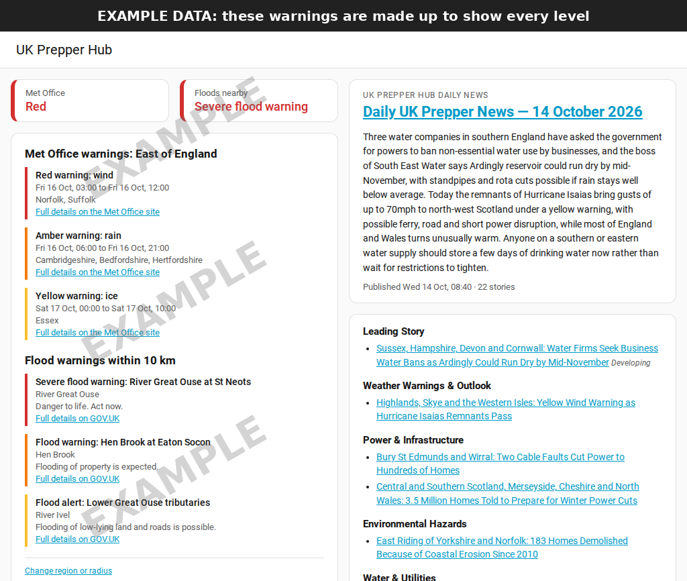
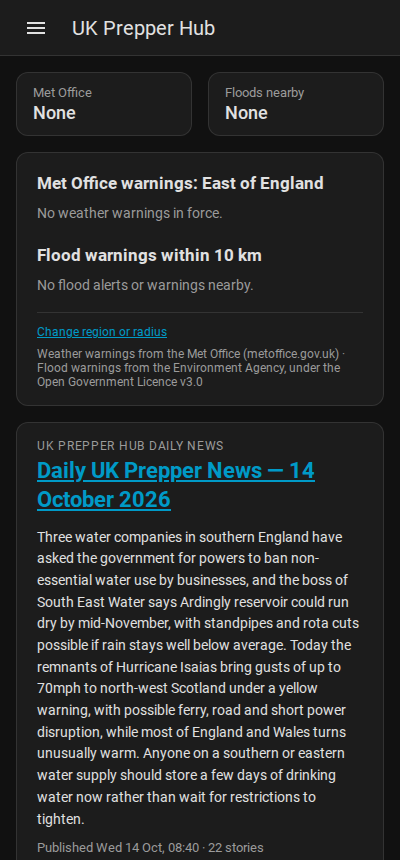
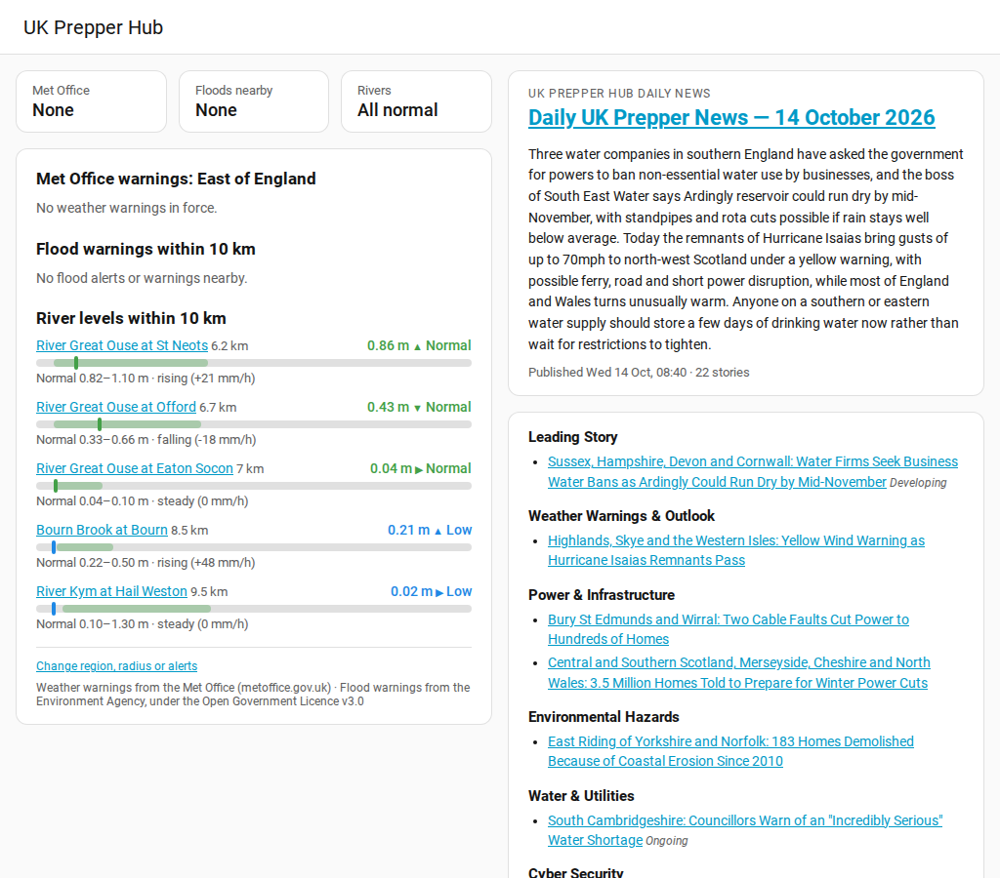
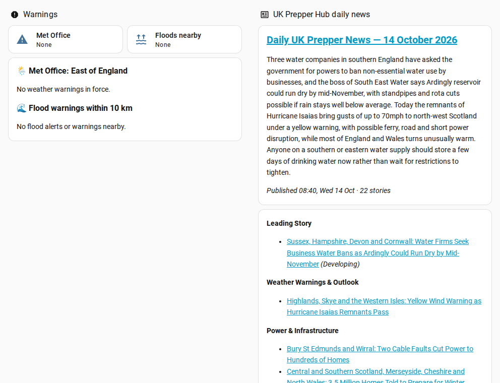

# UK Prepper Hub Alerts

A Home Assistant integration that brings UK hazard alerts and UK Prepper Hub's daily news into one place:

- **Met Office severe weather warnings** for your region (whole UK or any of the 16 Met Office regions)
- **Environment Agency flood warnings** near your home (England for now)
- **River levels** at every monitoring station near you: normal, high or very high, and whether it's rising
- **Phone alerts**, built in: get a notification the moment a serious warning is issued near you, with no automations to write
- **UK Prepper Hub Daily News**: today's headline, the Quick News Brief, and every story with a link

### Works straight after install, with nothing to build

- **It sets itself up.** Your Met Office region is picked automatically from your Home Assistant home location, so in most cases you just click **Submit**.
- **It adds a UK Prepper Hub entry to your sidebar menu** with your warnings, river levels and today's news on one page, so there are no dashboards or cards to build.
- **Phone alerts work out of the box.** Phones with the Home Assistant app are ticked for alerts during setup, with sensible levels already chosen (amber or red weather warnings, flood warnings, rivers very high and rising). Untick anything you don't want.
- **The menu entry is removable.** Don't want it in your sidebar? Switch it off any time under **Configure**, and switch it back on just as easily. The sensors keep working either way.
- **It also gives you normal sensors** for your own dashboards and automations, such as a phone alert when an amber warning or a flood warning is issued near you.


<sub>Example data showing every warning level. With nothing in force, each section simply says so.</sub>

---

## Contents

1. [Requirements](#requirements)
2. [Installation](#installation)
3. [Setting it up](#setting-it-up)
4. [The UK Prepper Hub page](#the-uk-prepper-hub-page)
5. [River levels](#river-levels)
6. [Phone alerts](#phone-alerts)
7. [Finding your sensors](#finding-your-sensors)
8. [Optional: a dashboard of your own](#optional-a-dashboard-of-your-own)
9. [Automation examples](#automation-examples)
10. [Changing your settings](#changing-your-settings)
11. [Updating and removing](#updating-and-removing)
12. [Sensor reference](#sensor-reference)
13. [Troubleshooting](#troubleshooting)
14. [Privacy](#privacy)
15. [Data sources and attribution](#data-sources-and-attribution)

---

## Requirements

- Home Assistant 2025.1 or newer
- [HACS](https://hacs.xyz/) installed, for the easy install route. Manual install works without it.
- Your home location set in Home Assistant (**Settings → System → General**), which the flood warnings use
- An internet connection. No accounts or API keys are needed.

## Installation

### Option A: through HACS (recommended)

1. Open **HACS** in the Home Assistant sidebar.
2. Click the **⋮** menu (top right) and choose **Custom repositories**.
3. In **Repository**, paste:
   `https://github.com/netneo/ha-ukph-alerts`
   Set **Type** to **Integration**, then click **Add**.
4. Close that box, search HACS for **UK Prepper Hub Alerts**, open it and click **Download**, then **Download** again to confirm.
5. **Restart Home Assistant** (**Settings → System → ⏻ top right → Restart Home Assistant**).

### Option B: manual install

1. Download the latest release from the [Releases page](https://github.com/netneo/ha-ukph-alerts/releases).
2. Copy the `custom_components/ukph_alerts` folder into your Home Assistant `config/custom_components/` folder, creating `custom_components` if it doesn't exist. You should end up with `config/custom_components/ukph_alerts/manifest.json`.
3. Restart Home Assistant.

## Setting it up

1. Go to **Settings → Devices & services**.
2. Click **+ Add integration** (bottom right) and search for **UK Prepper Hub Alerts**.
3. Check the settings. They're already filled in for you:
   - **Met Office warning region**: picked automatically from your Home Assistant home location. Change it if it's wrong, which can happen if you live near a regional border. Choose *Whole UK* if you want every warning in the country.
   - **Search radius for flood warnings and river levels**: how far from your home to look, in km. 10 km is a good start.
   - **Show UK Prepper Hub in the sidebar**: on by default.
   - **Send alerts to these phones**: every phone with the Home Assistant app is ticked. Untick any that shouldn't get alerts.
   - **Alert levels** for Met Office warnings, flood warnings and rivers, plus an optional "all clear". See [Phone alerts](#phone-alerts).
4. Click **Submit**. Your sensors appear straight away, and so does **UK Prepper Hub** in the sidebar.

> Only one copy of the integration can be set up per Home Assistant install.

## The UK Prepper Hub page

Click **UK Prepper Hub** in the sidebar. You'll see:

- **Warning badges** at the top, coloured yellow, amber or red when something is in force.
- **Met Office warnings** for your region, each with its times, the areas affected and a link to the full warning.
- **Flood alerts and warnings** within your radius, each with the Environment Agency's message and a link to GOV.UK.
- **River levels** at every station within your radius. See [River levels](#river-levels).
- **Today's UK Prepper Hub news**: the headline, the Quick News Brief, and every story grouped by section, each linking to that story.

How the warnings are shown:

| Level | Met Office | Environment Agency |
|---|---|---|
| 🔴 Red | Red warning | Severe flood warning (danger to life) |
| 🟠 Amber / orange | Amber warning | Flood warning (flooding expected) |
| 🟡 Yellow | Yellow warning | Flood alert (flooding possible) |

The badges at the top always show the highest level currently in force.

It follows your Home Assistant theme (light or dark) and works on phones and tablets. Everyone in the household can see it, not just admins.



**Removing the menu entry:** go to **Settings → Devices & services → UK Prepper Hub Alerts → Configure**, turn off **Show UK Prepper Hub in the sidebar**, and click **Submit**. The entry disappears straight away and your sensors and automations carry on working. Turn it back on the same way.

## River levels



Every Environment Agency river level station within your radius is included automatically, up to the nearest 30. Each one shows:

- **The level now**, in metres, measured against that gauge's own local zero. One river's 0.8 m can be normal while another's is a flood.
- **Normal, high, very high or low.** It compares the level against that station's own typical range (the green band on the bar). *High* means above the normal range. *Very high* means above the highest level it has reached recently.
- **The trend over the last hour**: ▲ rising, ▼ falling or ▶ steady, with the change in mm.
- **A link** to that station's page on GOV.UK, with graphs and history.

Each station is also a sensor, so you get a history graph for free. The **Rivers above normal** sensor counts how many are high, and **River high nearby** turns on when any of them is. The station list refreshes itself daily, and stations that move out of your radius are removed automatically.

## Phone alerts

Phones ticked during setup get a notification when something reaches the levels you've chosen. There are no automations to write.

| Type | Default | Other choices |
|---|---|---|
| Met Office warnings | Amber and red | Yellow and above · Red only |
| Flood warnings | Flood warnings and severe | Flood alerts and above · Severe only |
| Rivers | Above its highest recent level **and still rising** | Above its normal range · Above its highest recent level · Off |
| All clear | On | Off |

- **One alert per warning.** It won't repeat every few minutes. You get another only if the warning is upgraded, say from amber to red.
- **It remembers what it's sent,** so restarting Home Assistant doesn't re-send old alerts.
- **Tap the alert** to open the full warning on the Met Office or GOV.UK site.
- **A bad connection is not an all clear.** If a source can't be reached, it waits rather than telling you a warning has ended.
- If lots arrive at once (say five flood warnings in a storm), they're rolled into one summary alert.

Change any of this under **Configure**. For anything more, such as flashing your lights red or announcing on a speaker, every new or upgraded warning also fires a `ukph_alerts_new_warning` event you can trigger an automation from.

## Finding your sensors

- **Settings → Devices & services → UK Prepper Hub Alerts → 1 service** lists everything.
- Or go to **Settings → Devices & services → Entities** and search for `uk prepper`.

The sensors are:

| Entity ID | Shows |
|---|---|
| `sensor.uk_prepper_hub_alerts_met_office_warnings` | Number of Met Office warnings in force |
| `sensor.uk_prepper_hub_alerts_met_office_highest_warning` | `none`, `yellow`, `amber` or `red` |
| `sensor.uk_prepper_hub_alerts_flood_warnings_nearby` | Number of active flood alerts/warnings within your radius |
| `sensor.uk_prepper_hub_alerts_flood_highest_severity` | `none`, `flood_alert`, `flood_warning` or `severe_flood_warning` |
| `sensor.uk_prepper_hub_alerts_rivers_above_normal` | Number of nearby rivers above their normal range |
| `sensor.uk_prepper_hub_alerts_river_level_…` | One per station, e.g. `…_river_level_river_great_ouse_at_st_neots`: the level in metres |
| `sensor.uk_prepper_hub_alerts_daily_news` | Title of today's UK Prepper Hub news post |
| `binary_sensor.uk_prepper_hub_alerts_weather_warning_active` | On while any Met Office warning is in force for your region |
| `binary_sensor.uk_prepper_hub_alerts_flood_warning_nearby` | On while any flood alert or warning is within your radius |
| `binary_sensor.uk_prepper_hub_alerts_river_high_nearby` | On while any nearby river is above its normal range |

Click any sensor and open **Attributes** to see the full details: each warning's areas and times, the news brief, the list of stories, and so on.

## Optional: a dashboard of your own

You don't need this, because the sidebar page already shows everything. But if you'd like the same information as cards you can rearrange, a ready-made dashboard is included as [`examples/alerts-dashboard.yaml`](examples/alerts-dashboard.yaml):



1. Go to **Settings → Dashboards → + Add dashboard → New dashboard from scratch**.
2. Give it a name such as *Alerts*, pick an icon such as `mdi:alert-octagon`, and click **Create**.
3. Open the new dashboard from the sidebar.
4. Click the **pencil** icon (top right), then **⋮ → Raw configuration editor**.
5. Delete everything in the editor and paste in the whole of [`alerts-dashboard.yaml`](examples/alerts-dashboard.yaml). Use the **Raw** or copy button on GitHub to get it all.
6. Click **Save**, then **✕** and **Done**.

**Just want the news on an existing dashboard?** Edit the dashboard, **+ Add card → Markdown**, and paste this:

```yaml
type: markdown
content: >
  **[{{ states('sensor.uk_prepper_hub_alerts_daily_news') }}]({{ state_attr('sensor.uk_prepper_hub_alerts_daily_news', 'link') }})**

  {{ state_attr('sensor.uk_prepper_hub_alerts_daily_news', 'brief') }}
```

## Automation examples

To add one of these, go to **Settings → Automations & scenes → + Create automation → ⋮ → Edit in YAML**, paste it in, and save.

You don't need these for phone alerts, which are [built in](#phone-alerts). They're starting points for doing something different. Change `notify.mobile_app_your_phone` to your own phone. Look for it under **Settings → Devices & services → Mobile App**. Its entity ID starts with `notify.mobile_app_`.

**Phone alert for an amber or red Met Office warning:**

```yaml
alias: Met Office amber or red warning
triggers:
  - trigger: state
    entity_id: sensor.uk_prepper_hub_alerts_met_office_highest_warning
    to: [amber, red]
actions:
  - action: notify.mobile_app_your_phone
    data:
      title: "⚠️ Met Office {{ trigger.to_state.state }} warning"
      message: >
        
        {{ w.level | capitalize }} warning of {{ w.hazard }} from
        {{ as_timestamp(w.valid_from) | timestamp_custom('%a %H:%M') }}.
```

**Phone alert for any flood warning near you:**

```yaml
alias: Flood warning nearby
triggers:
  - trigger: state
    entity_id: sensor.uk_prepper_hub_alerts_flood_highest_severity
    to: [flood_warning, severe_flood_warning]
actions:
  - action: notify.mobile_app_your_phone
    data:
      title: "🌊 Flood warning near home"
      message: >
        
        {{ w.severity | replace('_', ' ') | capitalize }}: {{ w.description }}
```

**Turn a light red while any warning or flood alert is in force** (using the on/off sensors):

```yaml
alias: Warning light
triggers:
  - trigger: state
    entity_id:
      - binary_sensor.uk_prepper_hub_alerts_weather_warning_active
      - binary_sensor.uk_prepper_hub_alerts_flood_warning_nearby
    to: "on"
actions:
  - action: light.turn_on
    target:
      entity_id: light.hallway
    data:
      color_name: red
```

**Morning news headline:**

```yaml
alias: UK Prepper Hub morning news
triggers:
  - trigger: time
    at: "09:00:00"
actions:
  - action: notify.mobile_app_your_phone
    data:
      title: "{{ states('sensor.uk_prepper_hub_alerts_daily_news') }}"
      message: "{{ state_attr('sensor.uk_prepper_hub_alerts_daily_news', 'brief')[:250] }}…"
      data:
        url: "{{ state_attr('sensor.uk_prepper_hub_alerts_daily_news', 'link') }}"
```

## Changing your settings

**Settings → Devices & services → UK Prepper Hub Alerts → Configure** lets you change the Met Office region, the search radius, the sidebar page, which phones get alerts and at what levels, at any time. There's also a **Change region, radius or alerts** link at the bottom of the warnings on the UK Prepper Hub page. The integration reloads by itself, so there's no need to remove and re-add it.

Flood warnings and river levels always use Home Assistant's current home location. If you correct that location, they follow it automatically.

## Updating and removing

- **Updating (HACS):** HACS shows an update notice when a new version is released. Click **Update**, then restart Home Assistant.
- **Removing:**
  1. **Settings → Devices & services → UK Prepper Hub Alerts → ⋮ → Delete**.
  2. In HACS, open the integration, choose **⋮ → Remove**, and restart.

## Sensor reference

| Sensor | State | Attributes |
|---|---|---|
| Met Office warnings | Number of warnings in force | `region`, `highest_level`, `warnings`: a list with `level`, `hazard`, `region`, `areas`, `valid_from`, `valid_to`, `title`, `summary`, `link` |
| Met Office highest warning | `none` / `yellow` / `amber` / `red` | |
| Flood warnings nearby | Number of active flood alerts/warnings | `radius_km`, `highest_severity`, `warnings`: a list with `severity`, `description`, `county`, `river_or_sea`, `message`, `time_raised`, `link` |
| Flood highest severity | `none` / `flood_alert` / `flood_warning` / `severe_flood_warning` | |
| Rivers above normal | Number of nearby rivers above normal | `radius_km`, `rivers_above_normal` (river, station, level, status, trend, link), `stations_shown`, `stations_in_radius`, `stations` (every station's full details) |
| River level (one per station) | Level in metres | `river`, `station`, `status` (`low` / `normal` / `high` / `very_high`), `trend` (`rising` / `falling` / `steady`), `change_1h_m`, `typical_low`, `typical_high`, `highest_recent`, `max_on_record`, `distance_km`, `reading_time`, `link` |
| Weather warning active / Flood warning nearby / River high nearby | `on` / `off` | `count`, `details` (one line per warning or river) |
| Daily news | Title of today's post | `link`, `published`, `brief`, `story_count`, `stories`: a list with `section`, `section_slug`, `subsection`, `location`, `headline`, `status`, `url` |

How often each source is checked:

| Source | Every |
|---|---|
| Met Office | 10 minutes |
| Environment Agency (floods and river levels) | 15 minutes |
| UK Prepper Hub | 30 minutes |

The long attributes (`warnings`, `brief`, `stories`, `stations`) are kept out of Home Assistant's history database, so they don't make it grow.

## Troubleshooting

- **No UK Prepper Hub in the sidebar:** check **Show UK Prepper Hub in the sidebar** is on under Configure, then refresh your browser.
- **Can't find the integration in "Add integration":** make sure you restarted Home Assistant after installing, then refresh your browser. A hard refresh (Ctrl+F5) may be needed.
- **A sensor shows "Unavailable":** that source couldn't be reached on the last check. The other sensors carry on working, and it retries by itself. Check **Settings → System → Logs** for lines mentioning `ukph_alerts`.
- **Flood warnings and river levels empty in Scotland, Wales or Northern Ireland:** expected for now. The Environment Agency only covers England. Support for SEPA (Scotland), Natural Resources Wales and Northern Ireland is planned.
- **No phone alerts:** check your phone is ticked under Configure, and that the Home Assistant app on it has notifications allowed. Only warnings at or above your chosen levels send an alert.
- **Wrong area's flood warnings:** check your home location under **Settings → System → General**.
- **Found a bug?** Please [open an issue](https://github.com/netneo/ha-ukph-alerts/issues) and include any `ukph_alerts` log lines.

## Privacy

- Flood warnings and river levels use the home location set in Home Assistant, **rounded to about 1 km**, and send it only to the Environment Agency's API.
- Phone alerts go through Home Assistant's own app notifications. Nothing passes through UK Prepper Hub.
- Your location is never stored by this integration and never sent to UK Prepper Hub or the Met Office.
- No accounts, no tracking cookies, no API keys.
- Links to UK Prepper Hub include a `utm_source=homeassistant` tag, so the site can see that visits came from Home Assistant.

## Data sources and attribution

- Weather warnings © Crown copyright, from the [Met Office](https://www.metoffice.gov.uk/weather/warnings-and-advice/uk-warnings).
- Flood warnings and river levels from the [Environment Agency](https://check-for-flooding.service.gov.uk/), used under the [Open Government Licence v3.0](https://www.nationalarchives.gov.uk/doc/open-government-licence/version/3/). This data covers England only.
- News from [UK Prepper Hub](https://ukprepperhub.co.uk/).

This integration is not affiliated with or endorsed by the Met Office or the Environment Agency. Always follow official advice in an emergency.

## Licence

MIT. See [LICENSE](LICENSE).
